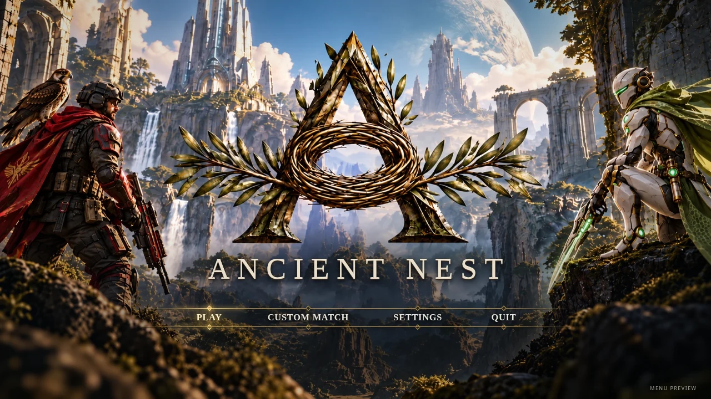

# Ancient Nest

Ancient Nest's cinematic main-menu preview, based on the reference artwork supplied for the project.



## Current status

The repository includes a working browser menu with Play, Custom Match, Settings, and Quit controls. It uses a generated adaptation of the supplied reference, with live title text and interactive menu controls over the artwork.

A Godot account integration package and Cloudflare accounts service are included below. The existing 10.2 game was found in connected Drive; it is not replaced by the browser preview. Current-game integration is being validated separately. Play and Custom Match open clearly labeled preview screens. Settings control menu sound and volume and save locally when browser storage is available. Quit shows an exit screen with a return action; it does not attempt to close the browser tab.

## Open the menu

Open `index.html` in a modern browser. No installation or build step is required.

For a local HTTP preview, run this command from the repository directory, then visit <http://localhost:8000>:

```sh
python3 -m http.server 8000
```

Use a mouse, touch, or keyboard. Tab moves between controls; arrow keys change the menu selection; Enter activates it; Escape closes a dialog or returns from the exit screen.

## Structure

- `index.html`: browser preview entry point.
- `src/menu.css`: responsive layout and menu styling.
- `src/menu.js`: navigation, preview screens, and saved settings.
- `assets/main-menu.webp`: generated adaptation of the reference artwork.
- `docs/main-menu.md`: design notes and implementation status.

## Copy and paste into Cloudflare

Open [the Cloudflare setup prompt](ancient-nest-accounts/cloudflare-paste/PASTE-INTO-CLOUDFLARE-ASSISTANT.txt)
and paste its complete contents into your authenticated Cloudflare assistant.
For dashboard-only deployment, [START-HERE.txt](ancient-nest-accounts/cloudflare-paste/START-HERE.txt)
explains where to paste the prebuilt Worker and SQL. Existing data and secrets are
preserved; the database is not recreated. Provider secret values still come from
your own accounts and go into Cloudflare's secure secret fields.

After deployment, `/setup-test` on the accounts Worker tests real email/SMS codes,
session refresh and Discord identity linking. The [Windows checks workflow](.github/workflows/windows-client.yml)
exercises native SDK loading, credential storage, Windows export and executable startup.
Microphone and personal friends-call behavior require a two-person device test.

## Windows one-click setup and launch

In the full download, double-click **Setup Ancient Nest.cmd** to configure and deploy
the service. The shortcut installs Node.js if needed, opens Cloudflare login, applies
migrations, asks securely for missing provider credentials, and checks readiness.
You need your existing Cloudflare, Resend, Twilio, and Discord accounts for that
first setup. It preserves existing secrets and does not reset the database.

For players, open **Play Ancient Nest.cmd** in the full download, or extract the
Windows player ZIP and open **Ancient Nest.exe**. Godot
and terminal commands are not needed. The full download includes the player folder;
source checkouts use the [build instructions](ancient-nest-accounts/README.md#windows-shortcuts-and-download).
This is an account/voice starter; gameplay and live deployment are still outstanding.

## Godot login and accounts service

The [accounts project](ancient-nest-accounts/README.md) includes a D1-backed Cloudflare
Worker and a [Godot 4 client](ancient-nest-accounts/godot-client/README.md). Registration
requires email and phone. The client automatically attempts saved sign-in when the
game starts, continues on success, and requires manual login if restoration fails.
It also includes Discord account linking and team-voice integration.

Install the project dependencies and pinned native addons:

```sh
cd ancient-nest-accounts
npm ci
npm run discord:install
```

Open `ancient-nest-accounts/godot-client/project.godot` in Godot 4.4 or newer
(validated with 4.6.3). The startup scene is the account screen. The standalone client shows signed-in status. [Connect Existing Game.cmd](<Connect Existing Game.cmd>)
installs the adapter into an extracted existing game while preserving its original
intro, maps and gameplay. See [current-source status](ancient-nest-accounts/docs/EXISTING_GAME_INTEGRATION.md)
before applying it to 10.2. No substitute gameplay has been added.

The Worker configuration already identifies the existing `ancientnestaccounts`
D1 database and Discord application. Follow the [deployment instructions](ancient-nest-accounts/README.md#install-and-deploy)
to authenticate Cloudflare, apply migrations, configure provider secrets, and deploy.
The default accounts URL is configured in the Godot project; it must point to the
live deployed service. Adding these files does not deploy Cloudflare resources.

Native binaries are installed by the checksum-verified installer and are ignored
by Git. No production credentials are included. Persistent sign-in needs a working
OS credential store; Discord voice and microphone behavior require live desktop testing.

## Current integration status

The 10.2 source archive was found in Drive, but its download host is blocked in this
workspace. The adapter was inspected against the available 8.0 game and 9.0
coordinator reference. Do not downgrade the current game or overwrite the current
coordinator with those older versions. Latest-game compatibility, live deployment,
real delivery and two-player voice remain pending until the required access and
devices are available.

## Get the repository

Clone the repository from GitHub:

```sh
git clone https://github.com/perdoobie-glitch/Ancient-Nest.git
cd Ancient-Nest
```
